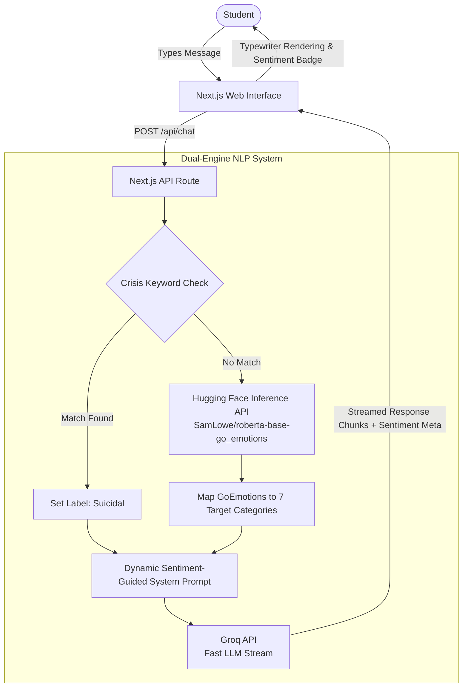

# Mira — Mental Health Sentiment Analyzer & Companion

> A compassionate, AI-powered conversational companion and sentiment analyzer designed to provide university students with private, accessible, and stigma-free emotional support.

Developed as part of a Computer Science Final Year Project at the **Federal University of Technology, Owerri (FUTO)**.

---

## 📖 Overview

University life often brings intense academic pressure, financial strain, loneliness, and stress. Due to stigma and limited on-campus counseling resources, many students suffer in silence.

**Mira** acts as an empathetic, always-available digital companion. It provides a judgment-free, confidential space where students can express what they are feeling. Behind the scenes, Mira performs real-time emotional sentiment analysis and tailors conversational replies with appropriate empathy, validation, and crisis intervention protocols.

### Key Pillars
- **Zero Stigma & High Privacy**: Conversations are held entirely in browser session memory (`sessionStorage`) — no messages or identifiable student records are stored in a database.
- **Dual-Engine NLP Pipeline**: Combines a dedicated emotion classification model with an ultra-fast LLM generator.
- **Crisis Safety Net**: Heuristic pattern detection identifies acute distress and triggers immediate, compassionate crisis helpline referrals (e.g., 988 Suicide & Crisis Lifeline).
- **Midnight Library Aesthetic**: A soothing dark-mode visual theme (OKLCH color space) crafted to reduce anxiety and eye fatigue.

---

## 🏗️ Architecture & How It Works



1. **Safety Heuristics**: When a message arrives, it is immediately checked against acute self-harm and crisis patterns.
2. **Emotion Classification**: Messages are sent to Hugging Face running `SamLowe/roberta-base-go_emotions`. The resulting emotion tags are mapped into one of seven core categories:
   - **Normal** — Balanced, neutral, or positive everyday reflection.
   - **Stress** — Academic overload, tension, or frustration.
   - **Anxiety** — Worry, nervousness, or fear.
   - **Depression** — Persistent sadness, grief, or hopelessness.
   - **Bipolar** — Rapid mood signals or emotional disorientation.
   - **Personality Disorder** — Interpersonal friction, rejection, or distress.
   - **Suicidal** — Serious emotional crisis requiring immediate intervention.
3. **Sentiment-Conditioned Prompting**: The detected emotion and confidence score calibrate the system prompt, instructing the conversational model to adopt the right empathetic tone (e.g., validating feelings without diagnosing or lecturing).
4. **Streaming Delivery**: The response streams back via HTTP chunked transfer. The first chunk delivers sentiment metadata for the UI badge, followed by real-time LLM token streaming with a gentle typewriter animation.

---

## 💻 Tech Stack

- **Framework**: [Next.js 15](https://nextjs.org/) (App Router, Turbopack)
- **Frontend**: [React 19](https://react.dev/), [TypeScript](https://www.typescriptlang.org/)
- **Styling**: [Tailwind CSS v4](https://tailwindcss.com/) with OKLCH color palettes and glassmorphism panels
- **Emotion NLP**: [@huggingface/inference](https://github.com/huggingface/huggingface.js) (`SamLowe/roberta-base-go_emotions`)
- **Language Generation**: [groq-sdk](https://github.com/groq/groq-typescript) (Fast inference with models like `openai/gpt-oss-20b`)

---

## 📂 Project Structure

```text
mira-app/
├── src/
│   ├── app/
│   │   ├── api/
│   │   │   └── chat/
│   │   │       └── route.ts         # Dual-engine API route (Classifier -> Prompt -> Groq stream)
│   │   ├── globals.css              # Custom themes, OKLCH tokens, keyframes, scrollbars
│   │   ├── layout.tsx               # Root layout and metadata
│   │   └── page.tsx                 # Core chat layout, typewriter logic, session state
│   ├── components/
│   │   ├── ChatInput.tsx            # Multi-line expanding chat input with send triggers
│   │   ├── MessageItem.tsx          # Chat bubble rendering, timestamp, and sentiment display
│   │   ├── SentimentBadge.tsx       # Emotion status badge with dynamic palette
│   │   ├── Sidebar.tsx              # Desktop & mobile navigation, emotion legend, reset
│   │   ├── Topbar.tsx               # Mobile header with status indicators
│   │   └── WelcomeView.tsx          # Initial greeting and suggested conversation prompts
│   ├── lib/
│   │   ├── classifier.ts            # Hugging Face inference caller & GoEmotions mapping
│   │   └── constants.ts             # Sentiment styles, colors (OKLCH), icons, and labels
│   └── types/
│       └── chat.ts                  # Message and role TypeScript interfaces
├── evaluate_classifier.mjs          # Standalone classifier evaluation test runner
├── .env.example                     # Environment variable blueprint
├── package.json
└── tsconfig.json
```

---

## 🚀 Getting Started

### 1. Prerequisites
- [Node.js](https://nodejs.org/) (version 18 or newer recommended)
- `npm` or `pnpm`
- A [Groq API Key](https://console.groq.com/)
- A [Hugging Face User Access Token](https://huggingface.co/settings/tokens)

### 2. Installation
Clone the repository and navigate into the `mira-app` directory:

```bash
cd mira-app
npm install
```

### 3. Environment Configuration
Copy the template file to `.env.local`:

```bash
cp .env.example .env.local
```

Open `.env.local` and provide your credentials:

```env
# Groq API key — https://console.groq.com
GROQ_API_KEY=your_groq_api_key_here

# Hugging Face token — https://huggingface.co/settings/tokens
HF_TOKEN=your_huggingface_token_here
```

### 4. Running the Development Server
Start the development server with:

```bash
npm run dev
```

Open [http://localhost:3000](http://localhost:3000) in your browser to interact with Mira.

### 5. Production Build
To create an optimized production build:

```bash
npm run build
npm run start
```

---

## 🧪 Classifier Evaluation

The project includes an evaluation suite in `evaluate_classifier.mjs` containing 40+ curated test cases reflecting realistic student messages across all 7 categories.

To run the evaluation:

```bash
node evaluate_classifier.mjs
```

This script evaluates accuracy, prints a category-by-category confusion matrix, and exports performance metrics.

---

## ⚠️ Important Disclaimers

1. **Non-Clinical Tool**: Mira is an AI-powered supportive companion and educational project. It is **not** a licensed therapist, psychologist, or medical service, and does not offer clinical diagnoses or prescriptions.
2. **Emergency Situations**: If you or someone you know is in immediate crisis, please seek immediate professional assistance or contact emergency services:
   - **US / International**: Dial or text **988** ([988 Suicide & Crisis Lifeline](https://988lifeline.org/))
   - **Nigeria**: Emergency lines or local emergency contacts (e.g., MANI - Mentally Aware Nigeria Initiative).
